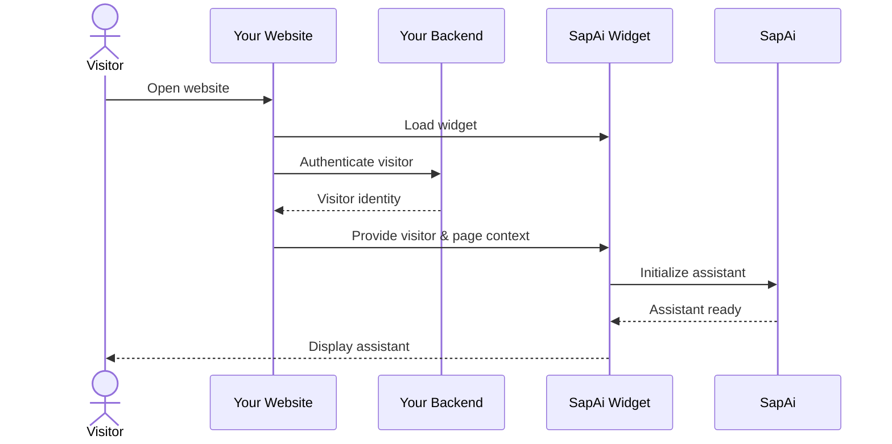

# Developer Docs

Integrate the **SapAi Widget** into your website and connect it to your application.

These docs are for **customer engineers** integrating SapAi into an existing web application.

## Guides

| Guide | Description | Status |
| --- | --- | --- |
| [Embedding the Widget](./embedding-widget.md) | Install `widget.js`, public key, embed URL, optional controls. | Available |
| [Visitor JWT](./visitor-jwt.md) | Authenticate visitors and pass identity and page context to SapAi. | Available |

## Who These Docs Are For

These docs are for developers integrating SapAi into an existing application.

You will typically:

* Add the SapAi Widget to your website.
* Connect your application to SapAi.
* Provide visitor identity and relevant page context.
* Configure the integration for your application's needs.

Your existing application remains responsible for its own authentication and application logic.

## Integration Flow

At a high level:

## Next Step

Start with the guide that matches your integration:

1. **[→ Embedding the Widget](./embedding-widget.md)**   one script tag
2. **[→ Visitor JWT](./visitor-jwt.md)**   identity and page context
