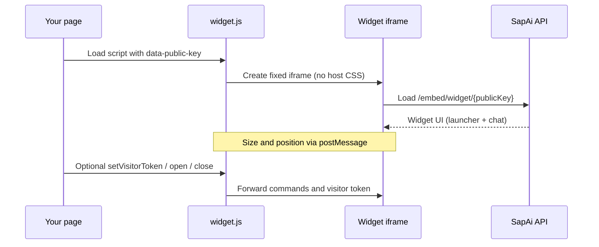

# Embedding the Widget

Add one script tag to your site. The widget positions, sizes, and animates itself. **No CSS is added to your page.**

## Contents

* [Install](#install)
* [How it works](#how-it-works)
* [Public key & embed URL](#public-key--embed-url)
* [Optional controls](#optional-controls)
* [Visitor identity (optional)](#visitor-identity-optional)
* [Allowed domains](#allowed-domains)
* [Checklist](#checklist)
* [Troubleshooting](#troubleshooting)

---

## Install

Copy the install snippet from your SapAi project → **Widget** settings, or use this shape:

```html
<script
  src="https://YOUR_SAPAI_ORIGIN/widget.js"
  data-public-key="YOUR_PUBLIC_KEY"
  async
></script>
```

Example (local / your origin will differ in production):

```html
<script
  src="http://localhost:3000/widget.js"
  data-public-key="c3e595a262334d36c91bde6cca787192"
  async
></script>
```

Place it **anywhere** in your HTML (often once in the site layout, before `</body>`).

That is enough for an anonymous chat launcher on every page.

---

## How it works



| Piece | Role |
| --- | --- |
| `widget.js` | Tiny host loader. Creates one fixed iframe. Does **not** inject stylesheets into your page. |
| Iframe | Runs the widget UI in isolation at `/embed/widget/{publicKey}`. |
| Your page | Only loads the script (and optionally pushes a visitor JWT). |

The loader owns the iframe’s **box** (position / size). The widget document owns everything visible (launcher, panel, animation). Host CSS cannot restyle the chat UI inside the frame.

Install **once** in your layout. Do not remount the script on every route change.

---

## Public key & embed URL

From Widget settings (same values the UI labels **Public key** and **Embed URL**):

| Field | Example | Use |
| --- | --- | --- |
| **Public key** | `1223334444555556666667777777` | `data-public-key` on the script tag |
| **Embed URL** | `/embed/widget/1223334444555556666667777777` | Path the iframe loads (relative to your SapAi origin). You normally do **not** open this yourself   `widget.js` does. |

The public key identifies **which project’s widget** to load. It is not a secret (it is embedded in the page), but only hosts you allow (see [Allowed domains](#allowed-domains)) should load it in production.

---

## Optional controls

After the script loads, a global API is available:

```js
window.SapAiWidget.open()
window.SapAiWidget.close()
window.SapAiWidget.setVisitorToken(token)
window.SapAiWidget.onVisitorTokenRequest(() => { /* remint + setVisitorToken */ })
window.SapAiWidget.destroy()
```

| Method | Purpose |
| --- | --- |
| `open()` | Open the chat panel |
| `close()` | Close the chat panel |
| `setVisitorToken(token)` | Pass a short-lived visitor JWT (see [Visitor JWT](./visitor-jwt.md)) |
| `onVisitorTokenRequest(fn)` | Widget asks the host for a fresh token |
| `destroy()` | Remove the iframe (e.g. on logout / SPA teardown) |

If the script is still downloading, poll briefly until `window.SapAiWidget` exists, then call these APIs.

---

## Visitor identity (optional)

Anonymous embed works with only the script tag.

To tell SapAi **who** the visitor is (and optional page context for tools), mint a visitor JWT on **your** backend and push it:

```js
window.SapAiWidget.setVisitorToken(token)
```

Full guide: **[Visitor JWT](./visitor-jwt.md)**.

---

## Allowed domains

In Widget settings, configure which host origins may load the embed. Add your production and staging origins (e.g. `https://www.example.com`). Requests from other sites should not load your widget.

Also ensure the widget is **enabled** in SapAi, or the public embed will not load.

---

## Checklist

- [ ] Widget enabled in SapAi
- [ ] Allowed domains include your site origin
- [ ] One `<script … widget.js data-public-key="…">` in the layout
- [ ] Correct SapAi origin in `src` (production URL, not only localhost)
- [ ] (Optional) Visitor JWT mint + `setVisitorToken` for authenticated / contextual chat

---

## Troubleshooting

| Symptom | Check |
| --- | --- |
| Nothing appears | Widget enabled? Wrong `data-public-key`? Script blocked by CSP / ad blocker? |
| Blank or refused embed | Is your site origin in **Allowed domains**? |
| Looks unstyled / broken on your CSS | Expected that host CSS does not enter the iframe; if the launcher box is clipped, check parent `overflow` / transforms on the host |
| `SapAiWidget` is undefined | Script not loaded yet, or `src` 404   wait for load or check Network tab |
| Need login / project tools | Push a [Visitor JWT](./visitor-jwt.md); anonymous sessions have no `sub` / claims |

---

## Next step

Authenticate visitors and pass page context: **[Visitor JWT](./visitor-jwt.md)**
