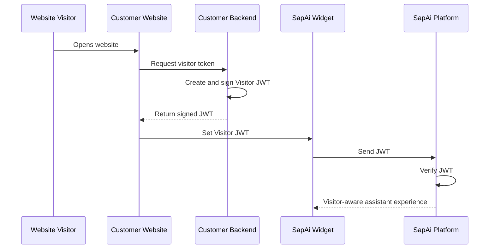
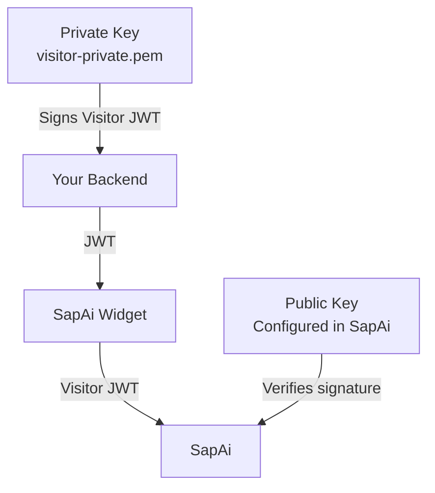
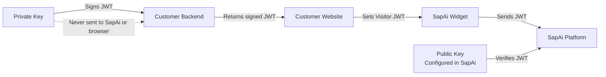

# Visitor JWT   Identity & Page Context

Visitor JWT allows your website to securely provide SapAi with a visitor's identity and relevant page context.

It is designed for websites where the SapAi Widget needs to understand **who the visitor is** and **what they are currently doing**, without exposing your website's primary authentication credentials to the widget.

## Contents

* [How Visitor JWT Works](#how-visitor-jwt-works)
* [Integration Overview](#integration-overview)
* [Configure Visitor JWT in SapAi](#configure-visitor-jwt-in-sapai)
* [Configure Your Client Backend](#configure-your-client-backend)
* [Embed the SapAi Widget](#embed-the-sapai-widget)
* [Good Patterns](#good-patterns)

  * [Token Lifetime](#token-lifetime)
  * [Reminting Tokens](#reminting-tokens)
  * [Clock Skew](#clock-skew)
  * [Understanding Claims](#understanding-claims)
  * [Using Claims as Context](#using-claims-as-context)
  * [Claims Are Context, Not Authorization](#claims-are-context-not-authorization)
  * [Updating Page Context](#updating-page-context)
* [Visitor Context in the Agent and MCP](#visitor-context-in-the-agent-and-mcp)
* [Security Guidelines](#security-guidelines)
* [Troubleshooting](#troubleshooting)
* [Production Checklist](#production-checklist)

---

# How Visitor JWT Works

Visitor JWT provides SapAi with a signed representation of the current website visitor.

The **customer backend** creates and signs the JWT. The website passes the signed token to the SapAi Widget, and SapAi verifies the token using the public key configured for that widget.

The browser never creates or signs the JWT.



The important security boundary is:



Your website's primary session cookie, access token, or internal authentication JWT should **not** be passed directly to the SapAi Widget.

Instead, your backend should issue a separate Visitor JWT containing only the information SapAi needs.

---

# Integration Overview

A typical integration consists of four main components:

1. **Your backend**   identifies the visitor and signs Visitor JWTs.
2. **Your website**   requests the token and passes it to the widget.
3. **SapAi Widget**   sends the Visitor JWT to SapAi.
4. **SapAi**   verifies the JWT and makes the verified visitor context available to the assistant.



The integration process is:

1. Enable Visitor JWT for your SapAi Widget.
2. Generate a signing key pair.
3. Configure the public key in SapAi.
4. Keep the private key on your backend.
5. Create an endpoint on your backend that issues Visitor JWTs.
6. Load the SapAi Widget on your website.
7. Request a Visitor JWT from your backend.
8. Pass the token to the widget.
9. Remint the token when the visitor's identity or relevant context changes.

---

# Configure Visitor JWT in SapAi

Before your backend can issue Visitor JWTs, configure SapAi to verify them.

## 1. Choose the signing algorithm

SapAi supports asymmetric signing algorithms such as:

* `RS256`
* `ES256`

For a straightforward setup, RSA with `RS256` is recommended.

## 2. Configure the issuer

The issuer identifies the system that creates the Visitor JWT.

For example:

```text
https://your-company.com
```

The value must match the `iss` claim in tokens generated by your backend.

## 3. Configure the public key

SapAi needs the **public key** corresponding to the private key your backend uses to sign Visitor JWTs.

The public key is safe to provide to SapAi because it can only be used to verify signatures.

The private key must remain on your backend.

## 4. Configure the audience

The audience identifies which SapAi Widget the token belongs to.

Use:

```text
sapai:widget:{YOUR_WIDGET_PUBLIC_KEY}
```

For example:

```text
sapai:widget:pk_123456789
```

Your backend must use the exact same value in the JWT's `aud` claim.

---

# Configure Your Client Backend

Your backend is responsible for creating Visitor JWTs.

## Generate a signing key pair

A JWT signed with an asymmetric algorithm uses two keys:

| Key         | Purpose               | Where it lives        |
| ----------- | --------------------- | --------------------- |
| Private key | Signs Visitor JWTs    | Customer backend only |
| Public key  | Verifies Visitor JWTs | SapAi                 |

### Option 1: Generate an RSA key pair online

For a simple RSA key-pair generator, you can use:

[CryptoTools RSA Generator](https://cryptotools.net/rsagen)

Use at least **RSA 2048-bit**.

After generating the keys:

* Copy the **public key** into SapAi.
* Store the **private key** securely on your backend.
* Never put the private key in frontend code.
* Never send the private key to SapAi.

### Option 2: Generate keys with OpenSSL

Generate a 2048-bit RSA private key:

```bash
openssl genrsa -out visitor-private.pem 2048
```

Extract the public key:

```bash
openssl rsa \
  -in visitor-private.pem \
  -pubout \
  -out visitor-public.pem
```

Your backend should use:

```text
visitor-private.pem
```

SapAi should receive:

```text
visitor-public.pem
```

The private key should never leave your backend environment.

---

## Create the Visitor JWT

A Visitor JWT contains standard JWT claims that identify the token and determine its validity.

A typical payload looks like:

```json
{
  "sub": "visitor-123",
  "iss": "https://your-company.com",
  "aud": "sapai:widget:pk_123456789",
  "iat": 1760000000,
  "exp": 1760003600,
  "claims": {
    "locale": "id-ID",
    "customerId": "customer-456",
    "productId": "product-789"
  }
}
```

### Required claims

| Claim | Description                              |
| ----- | ---------------------------------------- |
| `sub` | Stable identifier for the visitor        |
| `iss` | Issuer configured in SapAi               |
| `aud` | Audience configured for the SapAi Widget |
| `iat` | Time the token was issued                |
| `exp` | Time the token expires                   |

Your backend signs this payload using the private key.

### Node.js example

Using `jsonwebtoken`:

```typescript
import fs from "node:fs";
import jwt from "jsonwebtoken";

const privateKey = fs.readFileSync(
  "./visitor-private.pem",
  "utf8",
);

const token = jwt.sign(
  {
    claims: {
      locale: "id-ID",
      customerId: "customer-456",
      productId: "product-789",
    },
  },
  privateKey,
  {
    algorithm: "RS256",
    subject: "visitor-123",
    issuer: "https://your-company.com",
    audience: "sapai:widget:pk_123456789",
    expiresIn: "1h",
  },
);

console.log(token);
```

---

## Create a Visitor JWT endpoint

Your website should request the token from your backend.

For example:

```http
GET /api/sapai/visitor-jwt
```

The endpoint should:

1. Identify the current visitor using your existing authentication system.
2. Determine which information should be shared with SapAi.
3. Build the Visitor JWT payload.
4. Sign it using the private key.
5. Return the signed JWT.

Example response:

```json
{
  "token": "eyJhbGciOiJSUzI1NiIs..."
}
```

The endpoint can use your existing authentication system internally.

For example, your backend might already know:

```text
User ID:       12345
Customer ID:   customer-456
Plan:          premium
Locale:        id-ID
```

It can selectively expose this information through Visitor JWT claims.

---

# Embed the SapAi Widget

Load the SapAi Widget on your website.

The widget should be loaded once and remain mounted while the visitor navigates around your application.

After obtaining a Visitor JWT from your backend, pass it to the widget:

```javascript
const response = await fetch("/api/sapai/visitor-jwt");
const { token } = await response.json();

window.SapAiWidget?.setVisitorToken(token);
```

The website does **not** need to know or handle the private signing key.

---

# Good Patterns

This section covers patterns that are important once the basic integration is working.

---

## Token Lifetime

Visitor JWTs should be short-lived.

The default token lifetime is:

```text
1 hour
```

SapAi accepts tokens with a maximum lifetime of:

```text
24 hours
```

A Visitor JWT should represent the visitor's **current session/context**, rather than becoming a permanent identity credential.

For most applications, a short lifetime such as one hour is appropriate.

---

## Reminting Tokens

You do not need to recreate the SapAi Widget every time the visitor context changes.

Instead, keep the widget mounted and replace the Visitor JWT.

Remint a token when important visitor state changes.

Common examples include:

* Visitor logs in.
* Visitor logs out.
* Visitor switches account.
* Visitor switches organization.
* Visitor opens a different product.
* Visitor moves to a different page with different context.
* The current token is approaching expiration.
* SapAi requests a refreshed token.

For example:

```javascript
window.SapAiWidget?.onVisitorTokenRequest(async () => {
  const response = await fetch("/api/sapai/visitor-jwt");

  if (!response.ok) {
    throw new Error("Failed to obtain Visitor JWT");
  }

  const { token } = await response.json();

  return token;
});
```

You can also explicitly replace the current token:

```javascript
const response = await fetch("/api/sapai/visitor-jwt");
const { token } = await response.json();

window.SapAiWidget?.setVisitorToken(token);
```

### Login example

A visitor initially arrives anonymously:

```text
Visitor
  ↓
Anonymous JWT
  ↓
SapAi
```

After the visitor logs in:

```text
Visitor logs in
  ↓
Backend now knows customer identity
  ↓
Backend issues new Visitor JWT
  ↓
setVisitorToken(newToken)
  ↓
SapAi receives updated visitor context
```

The widget itself does not need to be recreated.

---

## Clock Skew

Distributed systems do not always have perfectly synchronized clocks.

For example:

```text
Customer Backend       SapAi
     12:00:00          11:59:58
```

A token generated close to its expiration time could otherwise appear slightly too early or too late.

SapAi allows a clock-skew tolerance of:

```text
60 seconds
```

You should still keep the clocks on your infrastructure synchronized using standard time synchronization.

Clock skew is a tolerance mechanism, not a reason to create unnecessarily long-lived tokens.

---

## Understanding Claims

A JWT contains **claims**   pieces of information about the token and its subject.

There are two useful categories.

### Registered claims

These are standard JWT fields:

```text
sub
iss
aud
iat
exp
```

They describe things such as:

* Who the token represents.
* Who issued it.
* Which audience it belongs to.
* When it was created.
* When it expires.

### Application claims

You can also provide additional information relevant to the SapAi experience.

For example:

```json
{
  "claims": {
    "locale": "id-ID",
    "customerId": "customer-456",
    "productId": "product-789",
    "orderId": "order-123",
    "page": "/checkout"
  }
}
```

These claims provide **context** that the agent can use when interacting with the visitor.

---

## Using Claims as Context

Claims are useful when the website already knows something important about the visitor or the current page.

For example:

| Claim        | Possible use                                     |
| ------------ | ------------------------------------------------ |
| `locale`     | Respond in the visitor's preferred language      |
| `customerId` | Associate the conversation with a customer       |
| `productId`  | Understand which product the visitor is viewing  |
| `orderId`    | Help answer questions about a specific order     |
| `page`       | Understand the visitor's current page            |
| `plan`       | Adapt explanations to the visitor's subscription |

For example, if the visitor is viewing:

```text
/products/pro-plan
```

your backend could issue:

```json
{
  "claims": {
    "productId": "pro-plan",
    "page": "/products/pro-plan"
  }
}
```

The agent can then understand that the conversation is happening in the context of that product.

### Keep claims small

Claims should contain only the information the assistant actually needs.

Supported application claim values should be simple:

* String
* Number
* Boolean
* `null`

Avoid:

* Nested objects
* Arrays
* Secrets
* Passwords
* API keys
* Internal session tokens
* Payment information
* Unnecessary personal information

Claim keys beginning with `_` are stripped.

The serialized claims JSON is limited to:

```text
4096 bytes
```

---

## Claims Are Context, Not Authorization

A Visitor JWT can tell SapAi something about the visitor.

It does **not** automatically give the visitor permission to access your data.

For example:

```json
{
  "claims": {
    "customerId": "customer-456"
  }
}
```

This tells SapAi that the visitor is associated with `customer-456`.

It does **not** mean that an MCP tool should automatically allow access to every record belonging to that customer.

Your backend tools should still validate authorization.

For example:

```text
Visitor JWT
     ↓
Verified visitor identity
     ↓
Tool receives customerId
     ↓
Backend checks authorization
     ↓
Only permitted data is returned
```

This distinction is especially important for MCP tools that access customer databases, orders, analytics, or other private resources.

---

## Updating Page Context

Page context can change while the visitor remains in the same session.

For example:

```text
Visitor opens Product A
        ↓
productId = product-a
        ↓
Visitor navigates to Product B
        ↓
productId = product-b
```

When important page context changes:

1. Your website requests a new Visitor JWT.
2. Your backend creates the token using the new context.
3. Your website calls `setVisitorToken()`.
4. The existing widget continues running.

For example:

```javascript
async function updateVisitorContext() {
  const response = await fetch("/api/sapai/visitor-jwt");

  if (!response.ok) {
    throw new Error("Failed to refresh Visitor JWT");
  }

  const { token } = await response.json();

  window.SapAiWidget?.setVisitorToken(token);
}
```

This is preferable to repeatedly destroying and recreating the widget.

---

# Visitor Context in the Agent and MCP

After SapAi verifies the Visitor JWT, the visitor information can be made available to the agent through SapAi-managed context.

Conceptually, the context looks like:

```json
{
  "_sapai": {
    "visitor": {
      "sub": "visitor-123",
      "claims": {
        "locale": "id-ID",
        "customerId": "customer-456",
        "productId": "product-789"
      }
    }
  }
}
```

This allows the agent and MCP tools to understand the visitor context without requiring the website to manually include it in every message.

For example, a visitor could ask:

```text
"What is the status of my order?"
```

The agent may already have:

```text
customerId = customer-456
orderId = order-123
```

as verified visitor context.

An MCP tool can then use that context when constructing its request.

However, tools should still enforce authorization independently.

---

# Security Guidelines

Follow these guidelines when deploying Visitor JWT in production.

### Keep the private key private

The private key should exist only in your backend environment.

Never:

* Put it in frontend JavaScript.
* Put it in the widget configuration.
* Send it to SapAi.
* Commit it to source control.
* Include it in API responses.

### Do not pass your primary authentication token

Do not expose your website's primary session JWT or access token to the SapAi Widget.

Instead:

```text
Your authentication
        ↓
Your backend
        ↓
Visitor JWT
        ↓
SapAi Widget
```

### Use HTTPS

The Visitor JWT is a credential and should only be transmitted over HTTPS.

### Keep tokens short-lived

Use an expiration time appropriate for your application.

### Minimize claims

Only include information that is useful to the assistant.

### Do not put secrets in claims

JWT payloads should never be treated as a secure place to store secrets.

### Enforce authorization separately

Visitor claims provide context.

Your backend and MCP tools remain responsible for deciding whether an operation is permitted.

---

# Troubleshooting

| Problem                    | Likely cause                                                         |
| -------------------------- | -------------------------------------------------------------------- |
| Invalid signature          | Public key does not match the private key used to sign the JWT       |
| Invalid audience           | `aud` does not match the configured widget audience                  |
| Invalid issuer             | `iss` does not match the SapAi configuration                         |
| Token expired              | `exp` is in the past                                                 |
| Token not active yet       | Token timing is outside the allowed clock-skew tolerance             |
| Visitor context is missing | Visitor JWT was not passed to the widget                             |
| Old page context remains   | A new Visitor JWT was not issued after the context changed           |
| Tool access is denied      | Visitor identity is valid but the backend authorization check failed |
| Claims are missing         | Claims are invalid, unsupported, oversized, or were stripped         |
